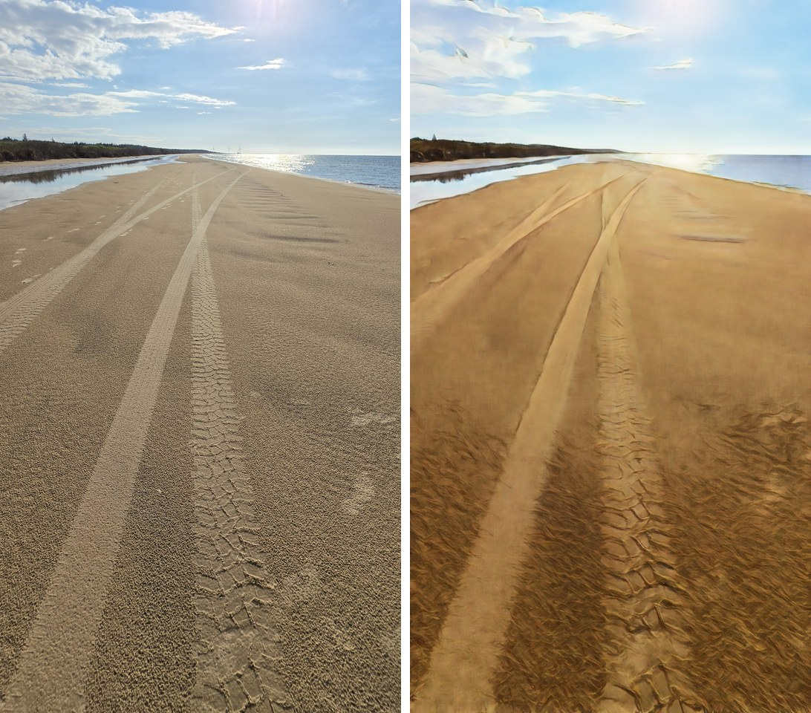

# MMM-GhibliFrame

A full-screen photo frame for [MagicMirror²](https://github.com/MagicMirrorOrg/MagicMirror) that shows your own photos **after an anime / Studio-Ghibli-style filter**, plus the overnight pipeline that prepares them on a Raspberry Pi.

*Cadre photo plein écran pour MagicMirror² : vos photos, stylisées « Ghibli » par un modèle AnimeGANv2, préparées chaque nuit par le Pi lui-même.*



*Left: original photo cropped to the screen ratio. Right: result of the overnight conversion (1080×1920 source, shown here at half size).*

Built and tested on a Raspberry Pi 5 (4 GB, Debian 12, MagicMirror 2.30, portrait screen 1080×1920, MMM-pages).

## How it works

1. **Night (cron)** – `nightly/nightly.sh` stops MagicMirror (frees ~1.4 GB of RAM), downloads the photos of your OneDrive albums, converts the new ones and restarts MagicMirror. It is capped to N hours and **always** restarts MagicMirror, even on error.
2. **Conversion (`nightly/ghibli.py`)** – crops each photo to the screen ratio (centred on faces, otherwise on the most detailed area), runs AnimeGANv2 (ONNX, CPU) on the whole image in one pass (~32 s and ~2.3 GB peak per 1080×1920 photo on a Pi 5), saves a JPEG into `nightly/ghibli/`. Resumable: a stopped night continues where it stopped.
3. **Photos removed from OneDrive** are moved to `nightly/backup/`, never deleted. Safety net: if fewer than 50 % of the known photos are still listed (API error), nothing is moved.
4. **Display (`MMM-GhibliFrame`)** – shows the `photos/` folder as a cross-fading slideshow, only while its page is visible (built for MMM-pages), one image loaded at a time.

## Install

```bash
cd ~/MagicMirror/modules
git clone https://github.com/Scottfx2/MMM-GhibliFrame.git
cd MMM-GhibliFrame
mkdir -p nightly/ghibli
ln -s "$PWD/nightly/ghibli" photos          # the module reads ./photos
```

Module config (give it its own MMM-pages page, e.g. `[ "MMM-GhibliFrame" ]`):

```js
{ module: "MMM-GhibliFrame", position: "fullscreen_below",
  config: { interval: 45000, fade: 2000, random: true } }
```

### Overnight pipeline (optional – you can also just drop JPEGs into `nightly/ghibli/`)

Requirements: [MMM-OneDrive](https://github.com/hermanho/MMM-OneDrive) already installed and signed in (the sync re-uses its token), pm2 running MagicMirror as `MagicMirror`, Python 3 with `python3-opencv`.

```bash
cd nightly
cp settings.example.json settings.json     # your OneDrive album names, screen size…
python3 -m venv --system-site-packages venv
venv/bin/pip install -r requirements.txt
# get an AnimeGANv2 ONNX model, see below, and put it in nightly/models/ghibli_v2.onnx
crontab -e   # 30 4 * * * /path/to/MMM-GhibliFrame/nightly/nightly.sh 5 >> /path/to/MMM-GhibliFrame/nightly/cron.log 2>&1
```

`nightly.sh [hours]` – default 5 h. Set `MM_DIR` if MagicMirror is not in `~/MagicMirror`.

### The model is **not** included

Get an AnimeGANv2 ONNX model yourself (the "Hayao" weights give the Ghibli / Miyazaki look) from [AnimeGANv2](https://github.com/TachibanaYoshino/AnimeGANv2) or one of its ONNX conversions, **and check its licence** (the AnimeGAN authors ask for permission for commercial use). `ghibli.py` expects a model with an input named `in`, NCHW float32 in [-1, 1], and an output of the same shape and range – adapt `stylize_band()` if yours differs.

## Settings (`nightly/settings.json`)

| key | meaning |
|---|---|
| `albums` | OneDrive album names to mirror |
| `width`, `height` | output size (screen resolution) |
| `jpeg_quality` | JPEG quality of the converted photos |
| `min_free_gb` | stop converting under this free disk space |
| `min_keep_ratio` | safety net against mass "disappeared" photos |

## Notes / limits

- Photos must be JPEG or PNG on OneDrive (HEIC is skipped).
- Running the model in horizontal bands (fallback when RAM is short) causes visible brightness seams because of the model's instance normalisation; the default single pass avoids them.
- A MagicMirror module must **not** define a method called `show()` – it overrides `Module.show()` and MMM-pages can then never reveal the module (the slideshow method is named `showNext()` for that reason).

## Credits

[AnimeGANv2](https://github.com/TachibanaYoshino/AnimeGANv2) (model), [MMM-OneDrive](https://github.com/hermanho/MMM-OneDrive) (OneDrive access), [MMM-pages](https://github.com/edward-shen/MMM-pages).

## Licence

MIT for the code in this repository (see `LICENSE`). The model and the photos are yours / their authors'.
